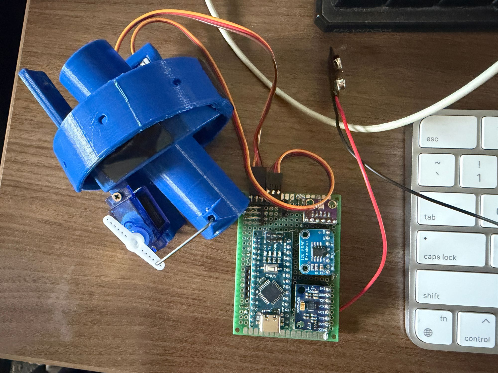

# TVC Model Rocket

A thrust-vector-controlled (TVC) model rocket flight computer, built for under $30. An Arduino Nano reads an IMU, estimates pitch and roll with a Kalman filter, and runs a PID loop that steers a 3D-printed two-axis motor gimbal with servos. Flight data is logged to an onboard FRAM chip for readback after recovery.



*Left: 3D-printed two-axis TVC mount with servos and pushrods. Right: flight computer on perfboard (Arduino Nano, MPU-6050, barometer, I2C FRAM).*

## Hardware

| Part | Role | Interface |
|---|---|---|
| Arduino Nano | Flight controller | — |
| MPU-6050 | 3-axis accelerometer + gyroscope | I2C `0x68` |
| BME280 barometric sensor | Altitude (also logs temperature) | I2C `0x76` |
| I2C FRAM breakout (32 KB) | Non-volatile flight data log | I2C `0x50` |
| 2× micro servos | Gimbal the motor mount | Pins D10 (pitch), D11 (roll) |
| 3D-printed TVC mount | Two-axis gimbal holding the motor tube | — |

All sensors share one I2C bus on a hand-soldered perfboard.

## How it works

1. **Startup:** centers both servos, initializes the MPU-6050 and BME280, and averages 100 barometer readings to set a ground-level baseline altitude.
2. **Orientation:** each loop computes pitch and roll from the accelerometer, then fuses them with gyro rates using a per-axis Kalman filter (angle + gyro bias).
3. **Altitude:** five barometer samples are averaged per loop and converted to feet above the baseline.
4. **Control:** once TVC is active, a PID controller (`Kp = 1.5`, `Ki = 0.1`, `Kd = 0.05`) drives pitch and roll toward 0°. It uses a 2° deadband on the integral term, per-servo calibrated center points and travel limits, optional output inversion, and exponential smoothing on servo commands.
5. **Logging:** writes CSV lines to FRAM — altitude every 0.1 s plus full data every 0.5 s before launch, then full data every 0.1 s after launch, for one minute.

### Flight stages

The firmware tracks the flight as a state machine, with transitions based on time and barometric altitude:

`Countdown (10 s)` → `Launch` → `TVC Active` (altitude > 6 ft) → `Apogee` (altitude falls 5 ft below peak) → `Descent` (< 100 ft) → `Parachute` (< 50 ft) → `Recovery` (< 10 ft)

## Data log

Each full log line is CSV:

```
timestamp_ms, temp_C, pitch_deg, roll_deg, servo1_pos, servo2_pos, altitude_ft
```

### Serial commands (9600 baud)

| Command | Action |
|---|---|
| `READLOG` | Print the logged flight data from FRAM |
| `WIPE` | Erase the FRAM and reset the write pointer |

## Building and flashing

1. Install the Arduino IDE and the **Adafruit BME280** and **Adafruit Unified Sensor** libraries.
2. Open `firmware/firmware.ino`, select **Arduino Nano**, and upload.
3. Calibrate `servo1_mid/left/right` and `servo2_mid/left/right` for your servos and mount, and set `invertServo1/2` so corrections move the right way.
4. Open the Serial Monitor at 9600 baud to watch live stage, altitude, pitch, roll, and servo output.

## Repository layout

```
firmware/firmware.ino   Flight computer code
images/                 Hardware photos
```
